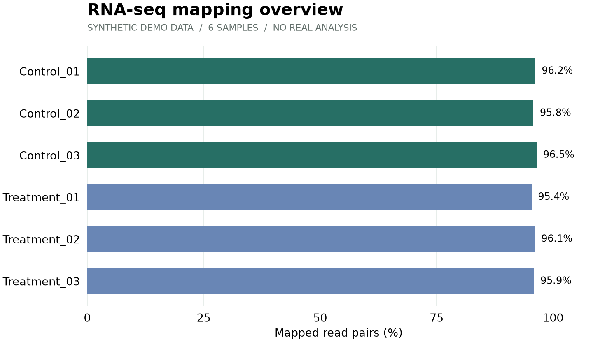

# RNA-seq 质控报告

**合成演示数据 · 非真实实验结果**

本报告展示 3 个 control 和 3 个 treatment 样本的阅读体验，不支持实际科学结论。
共有 150.3 M read pairs，平均比对率约 96.0%。

## 样本概览

| 样本 | Read pairs (M) | 比对率 | Q30 |
| --- | --- | --- | --- |
| Control_01 | 24.8 | 96.2% | 93.8% |
| Control_02 | 25.3 | 95.8% | 94.1% |
| Control_03 | 23.9 | 96.5% | 93.5% |
| Treatment_01 | 26.1 | 95.4% | 94.3% |
| Treatment_02 | 24.5 | 96.1% | 93.9% |
| Treatment_03 | 25.7 | 95.9% | 94.0% |

## 比对率图表

## 演示结论

6 个示例样本的比对率均高于示例阈值 90%。这是预先设定的合成数值，不能据此判断真实实验质量。
真实分析还需要结合实验设计、文库类型、污染、批次效应及下游用途进行评估。

[查看原始示例指标](../data/qc_metrics.csv)

[查看示例脚本](../scripts/qc_demo.py)
